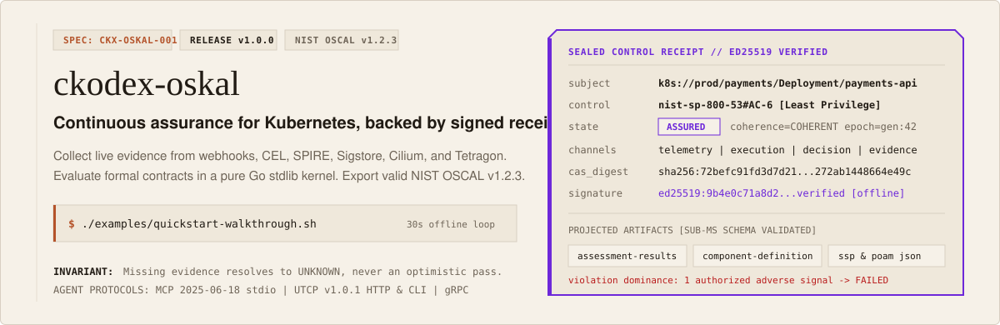
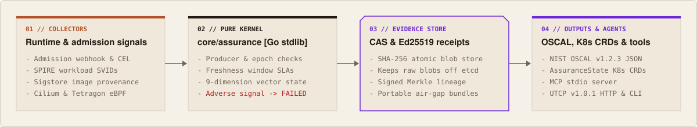

<p align="center">
  
</p>

<p align="center">
  <a href="https://ckodex-labs.github.io/ckodex-oskal/">Documentation</a> |
  <a href="#try-it-in-30-seconds">30-second demo</a> |
  <a href="#install">Install</a> |
  <a href="#connect-ai-agents-via-mcp-and-utcp">MCP &amp; UTCP</a> |
  <a href="#run-inside-kubernetes">Kubernetes CRDs</a> |
  <a href="https://github.com/ckodex-labs/ckodex-oskal/releases/tag/v1.0.0">Release v1.0.0</a>
</p>

<p align="center">
  <a href="https://github.com/ckodex-labs/ckodex-oskal/actions/workflows/ci.yml"></a>
  <a href="https://goreportcard.com/report/github.com/ckodex-labs/ckodex-oskal"></a>
  <a href="https://pages.nist.gov/OSCAL/"></a>
  <a href="LICENSE"></a>
</p>

Most compliance audits still run on screenshots and spreadsheets collected weeks after code ships. By the time an auditor reads a System Security Plan, the cluster has moved on.

`ckodex-oskal` evaluates Kubernetes workloads continuously and turns live signals from admission webhooks, CEL policies, SPIRE, Sigstore, Cilium, and Tetragon into SHA-256 content-addressed evidence envelopes and Ed25519-signed receipts. You can query the live state from your terminal, wire it into AI coding agents over MCP or UTCP, or export schema-valid NIST OSCAL v1.2.3 documents on demand.

If evidence is missing or expired, `oskal` reports `UNKNOWN` or `STALE` rather than an optimistic pass. If an authorized collector reports a violation, the control transitions to `FAILED` immediately regardless of how many other checks passed.

## Try it in 30 seconds

You do not need a running Kubernetes cluster to test the evaluation loop locally. Build the CLI and run the offline walkthrough script:

```bash
git clone https://github.com/ckodex-labs/ckodex-oskal.git
cd ckodex-oskal
make build
./examples/quickstart-walkthrough.sh
```

That script runs six real steps against a temporary store:

1. `oskal doctor` checks OS capabilities, kubeconfig, SPIRE socket, Sigstore root, and the 5 embedded NIST OSCAL v1.2.3 JSON schemas.
2. `oskal scaffold nist-sp-800-53` generates `EvidenceContract` and `ControlBinding` manifests plus a starter OSCAL Component Definition.
3. `oskal record admission` writes a content-addressed admission envelope and signs an Ed25519 receipt for `AC-6`.
4. `oskal inspect` reconstructs telemetry, execution, decision, and evidence traces for the workload.
5. `oskal export assessment-results | oskal validate -` exports NIST OSCAL v1.2.3 JSON and validates it offline in under a millisecond.
6. `oskal cockpit --once` prints a pure-ASCII snapshot of workload assurance state and Merkle lineage:

```text
SUBJECT                                       STATE     PRESENCE   VALENCE    COHERENCE   FRESHNESS
-------------------------------------------   -------   --------   --------   ---------   ---------
k8s://prod/payments/Deployment/payments-api   ASSURED   PRESENT    POSITIVE   COHERENT    FRESH
```

## Install

### Prebuilt binaries

Download the archive for `linux/amd64`, `linux/arm64`, `darwin/amd64`, `darwin/arm64`, or `windows/amd64` from [GitHub Releases](https://github.com/ckodex-labs/ckodex-oskal/releases/tag/v1.0.0) and verify `checksums.txt`.

### Go toolchain

```bash
go install github.com/ckodex-labs/ckodex-oskal/cmd/oskal@v1.0.0
```

### Container image

```bash
docker pull ghcr.io/ckodex-labs/oskal-controller:v1.0.0
```

## How it works

<p align="center">
  
</p>

- **Zero-dependency domain kernel.** `core/assurance` uses only the Go standard library. Kubernetes clients, gRPC servers, storage backends, and OSCAL serializers live in outer adapters.
- **Absence of evidence is `UNKNOWN`.** Unverified, missing, or expired observations resolve to `UNKNOWN` or `STALE`. They never default to `ASSURED`.
- **Violations dominate aggregate scores.** A single active violation from an authorized producer for the current epoch forces `FAILED`.
- **Forensic payloads stay off `etcd`.** Kubernetes `AssuranceState` resources store compact state vectors and SHA-256 digests while raw evidence lives in local or PVC-backed content-addressed storage.
- **Air-gap ready.** All five NIST OSCAL v1.2.3 schemas are compiled into the binary, and `airgap.ExportBundle` / `ImportBundle` move signed evidence across disconnected networks.

## Everyday CLI commands

| Task | Command |
| :--- | :--- |
| Run preflight health and CAS integrity checks | `oskal doctor --evidence-dir /var/lib/oskal/evidence` |
| Scaffold NIST SP 800-53, PCI-DSS, SOC 2, or ISO 27001 manifests | `oskal scaffold nist-sp-800-53 --workload payments-api --output yaml` |
| Import an existing OSCAL Component Definition into K8s CRDs | `oskal import oscal -f component-definition.json --namespace prod` |
| Check live assurance state for a workload | `oskal assurance state k8s://prod/payments/Deployment/payments-api` |
| Explain why a control is `ASSURED`, `UNKNOWN`, `STALE`, or `FAILED` | `oskal assurance explain k8s://prod/payments/Deployment/payments-api --control nist-sp-800-53:AC-6` |
| Reconstruct telemetry, execution, decision, and evidence traces | `oskal inspect k8s://prod/payments/Deployment/payments-api` |
| Export and validate NIST OSCAL v1.2.3 `assessment-results`, `component-definition`, `ssp`, `assessment-plan`, or `poam` | `oskal export ssp --subject k8s://prod/payments/Deployment/payments-api \| oskal validate -` |
| Verify an Ed25519 control receipt offline | `oskal assurance receipt verify --receipt-file /var/lib/oskal/evidence/rcpt-AC-6.json` |
| Open the live terminal dashboard | `oskal cockpit --refresh 2s` |
| Prune expired CAS envelopes safely | `oskal prune --older-than 336h --dry-run` |

## Connect AI agents via MCP and UTCP

`oskal` speaks both the Model Context Protocol `2025-06-18` and the Universal Tool Calling Protocol `v1.0.1` natively, without wrapper scripts or proxy servers.

### MCP server over stdio

Add `oskal mcp` to Claude Code, Cursor, VS Code, or any MCP client to expose 17 continuous assurance and governance tools over JSON-RPC 2.0:

```json
{
  "mcpServers": {
    "oskal": {
      "command": "oskal",
      "args": ["mcp", "--evidence-dir", "/var/lib/oskal/evidence"]
    }
  }
}
```

### Native UTCP v1.0.1 manual and server

Generate a spec-compliant UTCP v1.0.1 manual, start the governed HTTP tool server, or emit ready-to-run client configurations for `python-utcp`, `typescript-utcp`, `rs-utcp`, `go-utcp`, and `utcp-mcp`:

```bash
oskal utcp manual --base-url http://127.0.0.1:8090 > utcp-manual.json
oskal utcp validate utcp-manual.json
oskal utcp serve --addr 127.0.0.1:8090
oskal utcp sdk-config --lang python
```

When a `CapabilityLease` broker is active, every mutating or governed tool call requires a valid, non-expired lease ID and emits a hash-chained receipt. See [docs/architecture/UTCP-INTEGRATION.md](docs/architecture/UTCP-INTEGRATION.md) for SDK examples.

## Run inside Kubernetes

Install the CRDs and deploy `oskal-controller` with Helm:

```bash
kubectl apply -f config/crd/bases/

helm upgrade --install ckodex-oskal ./deploy/helm/ckodex-oskal \
  --namespace oskal-system \
  --create-namespace \
  --set persistence.enabled=true
```

`oskal-controller` reconciles six Custom Resource Definitions under `assurance.ckodex.io/v1alpha1`:

| CRD | Role |
| :--- | :--- |
| `ControlBinding` | Maps controls such as `AC-6` or `SC-7` to target Kubernetes workloads and links their `EvidenceContract`. |
| `EvidenceContract` | Declares required observation types, trusted SPIFFE producer patterns, and freshness windows. |
| `AssurancePolicy` | Configures admission rules, evaluation triggers, and enforcement scope. |
| `ControlException` | Records time-bounded risk exceptions with approver authority, justification, and compensating controls. |
| `AssuranceState` | Publishes the evaluated assurance vector, active epoch, and CAS evidence root back to the cluster. |
| `CapabilityLease` | Grants time-limited, revocable authority leases for agent workcells and governed UTCP tool calls. |

The validating admission webhook supports three `--webhook-mode` settings: `enforcing` blocks non-compliant pods and defaults fail-closed on misconfiguration, `warn` returns Kubernetes admission warnings while recording adverse evidence, and `audit` admits workloads with degraded-mode annotations and signed violation envelopes.

## Documentation and community

- **Full documentation.** [ckodex-labs.github.io/ckodex-oskal](https://ckodex-labs.github.io/ckodex-oskal/) covers tutorials, operator how-to guides, CLI flags, and CRD schemas.
- **Architecture and ADRs.** [docs/architecture/CKX-OSKAL-001.md](docs/architecture/CKX-OSKAL-001.md) and [docs/adr/](docs/adr/) explain the boundary between the domain kernel, adapters, and OSCAL projection.
- **Release verification gates.** [GATES.md](GATES.md) lists all 14 build, schema, race, and ASCII checks enforced by `make verify`.
- **Contributing and security.** Read [CONTRIBUTING.md](CONTRIBUTING.md) before opening a pull request, and see [SECURITY.md](SECURITY.md) to report vulnerabilities privately.

## License

Copyright 2026 CKODEX Labs. Licensed under the [Apache License, Version 2.0](LICENSE).
